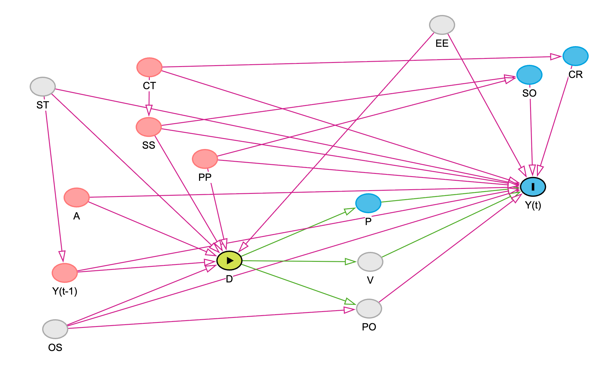

This is the README file

| Group | Paths (common cause) | Handled By | Checks |
| --- | --- | --- | --- |
| Stable per-game | ST (both rows) | Game fixed-effects (FE) | Pre-trends; balance on trends |
| Common across games | SS, CT → SS, CT → CR (common part), SO (common part) | Time FE | Drop storewide-sale windows; sale vs. off-sale |
| Observed, game-specific | A, PP, Y(t-1), SO/CR (varying part) | Control, match, or exclude | Balance, drop PP and release windows; alternative controls |
| Unobserved, game-specific | OS (both rows), EE | Not handled | Pre-trends; spike-exclusion; sensitivity; limitations |
| Collider | D → PO ← OS → Y | Don’t adjust for PO | None needed |
| Causal paths | D → P/V/PO → Y | Not blocked | None |